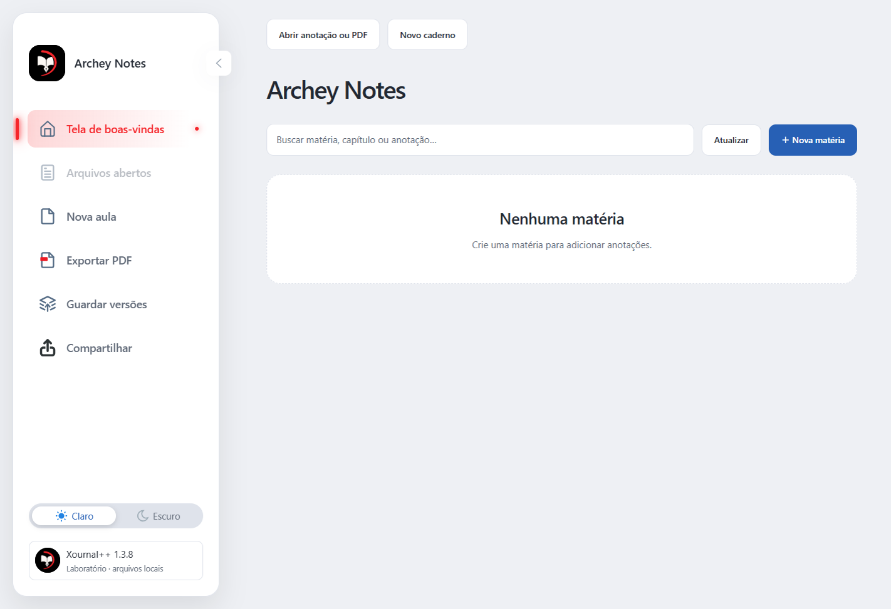

# Archey Notes

**Um projeto open source para aprimorar a experiência de escrever, anotar e estudar com o Xournal++.**

O Archey Notes combina o editor nativo do Xournal++ com um ambiente de estudos em Electron. O objetivo é preservar a escrita fluida e as ferramentas de anotação do projeto original, oferecendo uma interface mais organizada, personalizável e confortável para estudar.

Este é um projeto independente, derivado do [Xournal++](https://github.com/xournalpp/xournalpp). Não é uma versão oficial nem possui vínculo com sua equipe. O editor original, seus autores e as bibliotecas de terceiros mantêm os respectivos créditos e licenças.

## O que esta versão traz

- Ambiente de estudos com matérias, capítulos e organização de anotações.
- Editor Xournal++ integrado à janela Electron, com múltiplos documentos em abas nativas.
- Modos Clássico, Estúdio e Foco.
- Menu radial flutuante, reposicionável e animado, conectado às ferramentas e configurações nativas.
- Barra lateral com expansão suave, indicador animado e temas claro/escuro.
- Anotações em PDF, caneta, borracha, marca-texto e reconhecimento nativo de formas.
- Integração experimental Traços para converter escrita manual em texto usando o Windows Ink.
- Criação de anotações a partir de páginas em branco, pautadas e quadriculadas; exportação e empacotamento local.

## Baixar e abrir no Windows

Baixe o ZIP da seção **[Releases](https://github.com/miguelreiscarvalho/Archey-Notes/releases)**. Extraia todo o conteúdo para uma pasta com permissão de escrita e execute **Archey Notes.cmd**. Não execute diretamente de dentro do ZIP.

Esta prévia é para Windows 10/11 x64. O pacote inclui os runtimes do editor, Electron e Python. O reconhecimento manuscrito requer os componentes Windows Ink/.NET Framework e o recurso de escrita à mão em português (Brasil) instalado no Windows. O aplicativo tenta localizar `Microsoft.Ink.dll` na instalação do próprio Windows; essa biblioteca da Microsoft não é redistribuída neste pacote. Sem o motor disponível, a conversão pode ficar indisponível; a tinta deve ser preservada. LaTeX requer uma distribuição TeX instalada separadamente e configurada no editor.

**A distribuição começa vazia:** nenhuma matéria, capítulo, anotação pessoal, PDF, arquivo recente, autosave ou histórico do desenvolvedor é incluído. Os três modelos fornecidos são páginas sem conteúdo, geradas do zero. Os seus arquivos e configurações futuros ficam na pasta da instalação; uma nova versão não deve ser extraída por cima dos seus dados sem backup. Consulte [PRIVACY.md](PRIVACY.md).

## Estado do projeto

Prévia experimental `0.1.1-preview`, baseada no Xournal++ 1.3.8. Reconhecimento de texto, entrada por caneta/toque e integração das janelas Windows ainda precisam de testes em mais equipamentos. O código do editor permanece C++/GTK; o Electron organiza o ambiente externo. A referência visual de animação foi adaptada à tecnologia do projeto.

## Código, licença e contribuição

- `native/`: código-fonte completo do editor modificado, com documentação e testes do Xournal++.
- `app/`: interface Electron, biblioteca local e integração com o editor.
- `workflow/`: criação, exportação e empacotamento local de anotações.
- `plugins/`: integração de estudos e atalhos de geometria.
- `recognition/`: adaptador Traços e seu núcleo de reconhecimento Windows Ink.
- `scripts/`: compilação e inicialização.

O conjunto derivado é distribuído sob **GPL-2.0-or-later**, respeitando as licenças próprias dos componentes. O núcleo Traços mantém sua licença MIT. Consulte [LICENSE](LICENSE), [THIRD_PARTY.md](THIRD_PARTY.md) e [BUILDING.md](BUILDING.md).

Contribuições com correções, acessibilidade, testes com caneta e melhorias de interface são bem-vindas. Ao relatar um problema, remova documentos, nomes, caminhos e dados pessoais de capturas e logs.

---

**English:** Archey Notes is an independent open-source project improving the Xournal++ handwriting and study experience through an Electron study workspace, animated navigation, a native floating radial menu and experimental Windows Ink handwriting-to-text. It preserves the native C++/GTK editor. Windows previews ship with an empty library and no developer documents. GPL-2.0-or-later; third-party licenses are preserved.
